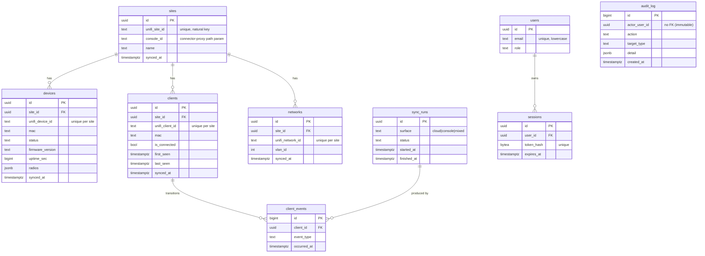

# Data model, schema & migration plan (ZENI-5)

- **Status:** Proposed (menunggu acceptance user) · **Tanggal:** 2026-10-06 · **Owner:** Raphael (Tech Lead)
- **DDL:** `migrations/0001_init.sql` (goose, forward-only)
- **Referensi:** `docs/adr/001-unifi-api.md` (dipakai lewat teks ADR-001), `docs/adr/002-tech-stack.md`, `docs/adr/003-architecture.md`

Dokumen ini menetapkan domain model, skema PostgreSQL awal, sumber setiap tabel
(UniFi vs internal), dan strategi migrasi. Semua keputusan bentuk data mengacu
pada **fakta terverifikasi di ADR-001** dan **domain type di ADR-003 §2** —
bukan asumsi.

---

## 1. Prinsip

1. **UniFi = source of truth; Postgres = cache + histori.** Setiap baris cache
   punya `source`, `synced_at`, dan `raw` (payload asli untuk audit + deteksi
   schema drift). Tidak ada tabel lokal yang menjadi sumber kebenaran state
   jaringan.
2. **Tidak ada destructive change tanpa approval.** Migrasi forward-only dan
   backward compatible (§6).
3. **Index pada kolom pencarian umum:** MAC, `site_id`, `device_id`.
4. **Scoping per site wajib** — baris cache anak selalu membawa `site_id`
   (fleet di runtime ini: 21 console / ~120 device).
5. **Kredensial tidak pernah masuk DB.** Tidak ada kolom yang menyimpan API key
   (ADR-003 §4).

---

## 2. ERD



`audit_log` berdiri sendiri: ia sengaja **tidak** punya FK ke `users`/`sites`
(lihat §4) supaya baris audit tetap immutable.

ERD ringkas (fallback ASCII):

```
sites ──< devices
      ──< clients ──< client_events >── sync_runs
      ──< networks
users ──< sessions
audit_log   (standalone, append-only)
sync_runs   (standalone, one row per sync cycle)
```

---

## 3. Sumber setiap tabel

| Tabel | Sumber | Endpoint / asal | `synced_at` | Catatan |
|---|---|---|---|---|
| `sites` | **UniFi** (cache) | Integration API `/sites`; `meta` dari Site Manager cloud | ya | `unifi_site_id` = natural key; `console_id` menyimpan host id untuk routing connector-proxy |
| `devices` | **UniFi** (cache) | Integration API `/sites/{id}/devices` (+ `/{deviceId}`); ringkasan dari cloud | ya | `radios`, `features` disimpan sebagai `jsonb`; `raw` menampung payload asli |
| `clients` | **UniFi** (cache) | Integration API `/sites/{id}/clients` (hanya klien **aktif**) | ya | `first_seen`/`last_seen` diakumulasi sendiri; `ssid`/`signal_dbm` belum tersedia di v1 |
| `networks` | **UniFi** (cache) | Integration API `/sites/{id}/networks` | ya | Ini *network*/VLAN, **bukan** WLAN/SSID — lihat §5 |
| `users` | **Internal** | dibuat lewat bootstrap/seed admin | — | Password argon2id |
| `sessions` | **Internal** | dibuat saat login | — | Hanya hash token yang disimpan |
| `audit_log` | **Internal** | ditulis aplikasi | — | Append-only |
| `sync_runs` | **Internal** | ditulis worker sync | — | Jejak per siklus; `error_kind` memetakan taxonomy adapter |
| `client_events` | **Internal** (turunan) | diff daftar klien aktif antar siklus | — | Append-only; hanya transisi, bukan snapshot tiap poll |

Yang **tidak** dibuat di `0001_init`:

| Tabel | Alasan | Kapan |
|---|---|---|
| `wifi_broadcasts` | Integration API v1 tidak mengekspos WiFi/SSID (`/wifi` → **404**, terverifikasi di ADR-001) | Setelah ada surface yang disetujui (classic controller API atau endpoint v1 baru) — butuh ADR baru |
| `consoles` / `hosts` | Scope awal fokus site/device/client/network; host health cukup di `sites.console_id` + Site Manager | Fase berikutnya bila dashboard butuh host/backup status |
| `device_stats` | Metrik per-device (cpu/mem/uptime/throughput) belum terkonfirmasi sebagai endpoint v1 yang andal | Setelah diverifikasi di staging |

---

## 4. Keputusan desain penting

### 4.1 Kunci & scoping

- **Surrogate PK lokal (`uuid`) + natural key UniFi.** Semua tabel cache punya
  `id uuid` internal dan `unifi_*_id` sebagai natural key. Upsert idempotent
  memakai `(site_id, unifi_*_id)`; tidak pernah memakai id UniFi sebagai PK
  supaya (a) tidak ada enumerasi id UniFi ke klien, (b) kunci bisa berubah bila
  ternyata id tidak unik global tanpa migrasi berdarah.
- **`site_id` di setiap baris anak** — scoping fleet wajib. Hapus site = hapus
  cache anaknya (`ON DELETE CASCADE`), bukan sebaliknya.
- **`clients` bukan cache stateless:** UniFi v1 hanya mengembalikan klien
  **aktif**, jadi `first_seen`/`last_seen` kita akumulasi. Saat klien hilang
  dari daftar aktif, worker men-set `is_connected=false` dan menulis
  `client_events('disconnected')` — **bukan** menghapus baris (histori).

### 4.2 Retensi klien — jawaban atas open question

Open question di catatan expert: *cache klien tiap N menit (tumbuh cepat) atau
snapshot + change event?*

**Keputusan: current-state cache + event transisi, tanpa snapshot tiap poll.**

- `clients` menyimpan satu baris **per klien** (bukan per poll): pertumbuhan
  `O(distinct client)`, bukan `O(client × poll)`.
- `first_seen`/`last_seen`/`is_connected`/`disconnected_at` merekam histori
  koneksi secara ringkas.
- `client_events` mencatat **hanya transisi** connect/disconnect:
  pertumbuhan `O(peristiwa)`, berguna untuk "kapan klien X terakhir lihat".
- Tidak ada tabel snapshot periodik. Kalau nanti butuh tren sinyal/throughput,
  itu telemetry terpisah (`device_stats`/`client_stats`) dengan retensi yang
  ditetapkan eksplisit — bukan dengan menumbuhkan `clients`.

Alasan: dataset aktif kecil, dan snapshot per poll membengkakkan DB tanpa
menjawab pertanyaan operator ("siapa terhubung sekarang" vs "kapan berubah").

### 4.3 `audit_log` immutable

`actor_user_id` dan `site_id` **tanpa FK**, dengan snapshot label
(`actor_label`). Audit adalah fakta historis: menghapus user atau membersihkan
cache site tidak boleh mengubah/menghilangkan jejak. Aplikasi tidak pernah
`UPDATE`/`DELETE` baris ini.

### 4.4 Tipe & enum

- `text` + `CHECK` untuk vocabulary terkontrol, **bukan** native enum Postgres:
  menambah/menghapus nilai cukup `ALTER ... DROP/ADD CONSTRAINT` di migrasi
  baru, tanpa rewrite tipe (native enum sulit menghapus nilai).
- `uuid` PK memakai `gen_random_uuid()` bawaan Postgres 16 (tanpa ekstensi).
- Log append-only memakai `bigint GENERATED ALWAYS AS IDENTITY` untuk urutan
  stabil.
- Waktu selalu `timestamptz` (UTC).

### 4.5 Field yang belum terverifikasi

- `clients.ssid`, `clients.signal_dbm` — **tidak** ada di Integration API v1
  (ADR-001). Kolom tetap ada (nullable) sebagai placeholder kontrak; worker
  tidak akan mengisinya sampai ada surface. Endpoint `/clients` (ZENI-6) harus
  menandai field ini sebagai tidak tersedia, bukan mengarang nilai.
- `devices.uptime_sec` — bentuk telemetry device belum terkonfirmasi di v1
  (`statistics` → 404 pada probe ADR-001). Kolom nullable; payload mentah
  selalu ada di `raw` sehingga tidak ada informasi yang hilang bila surface
  telemetry baru ditemukan.
- `networks.management/enabled/is_default/origin/configurable` berasal langsung
  dari response `/networks/{id}` yang terdokumentasi di ADR-001. Dua kolomnya
  nullable karena nilainya tidak selalu dilaporkan: `origin` dan `configurable`
  berasal dari objek `metadata` yang boleh tidak ada sama sekali, dan
  `management`/`vlan_id` tidak dilaporkan untuk network tipe WAN. Nilai yang
  tidak dilaporkan disimpan `NULL` dan disajikan `null` — bukan `false`/`0`,
  karena "UniFi tidak mengatakan" bukan klaim "tidak configurable".
  `management` dan `metadata.origin` dinormalisasi (`trim` + upper-case) di
  adapter, sehingga filter `?management=GATEWAY` tidak perlu tahu varian
  penulisan controller.

---

## 5. Koreksi: Networks ≠ WLANs

Catatan expert benar secara konseptual: UniFi memisahkan *network*
(VLAN/subnet/DHCP, `purpose: corporate|guest|wan|vlan-only`) dari *WiFi
broadcast* (SSID, security, MLO).

Namun **fakta terverifikasi ADR-001** menunjukkan Integration API v1:

- punya `GET /sites/{id}/networks` → ini network/VLAN, **tidak** membawa SSID
  atau security mode; dan
- **tidak** punya endpoint WiFi (`/wifi` → `404`, `wifi-broadcasts` tidak ada).

Konsekuensinya:

- `0001_init` hanya membuat tabel `networks` (sumber nyata). Membuat
  `wifi_broadcasts` sekarang berarti tabel kosong tanpa penulis — melanggar
  prinsip "tidak ada skema spekulatif".
- `wifi_broadcasts` masuk sebagai **migrasi lanjutan** begitu ada surface yang
  disetujui, dengan bentuk yang sudah dirancang: `(id, site_id,
  unifi_wifi_id UNIQUE per site, ssid, security_mode, enabled, vlan_id, raw,
  synced_at, source)`.
- **Tindak lanjut untuk ZENI-6:** `GET /networks` pada kontrak OpenAPI harus
  memetakan ke tabel `networks` (VLAN/name), dan **tidak** menjanjikan SSID /
  security mode. Field stub `Network.SecurityMode` di `internal/unifi`
  telah dihapus pada ZENI-31 karena tidak pernah terisi dari v1, tidak memiliki
  kolom di tabel `networks`, dan tidak dijanjikan pada kontrak `openapi.yaml`.

---

## 6. Rencana strategi migrasi

### Tool & penamaan

- **Tool:** [`goose`](https://github.com/pressly/goose) (keputusan ADR-002),
  dijalankan sebagai step deploy container `api` sebelum proses utama.
- **Naming:** `NNNN_short_description.sql` (4 digit, urut). Migrasi pertama:
  `0001_init.sql`.
- **Format:** `-- +goose Up` / `-- +goose Down` dalam satu file.
- **Version table:** `goose_db_version` (dibuat otomatis oleh goose).

### Aturan forward-only & backward compatible

1. **Satu file = satu perubahan logis.** Jangan mengedit migrasi yang sudah
   dirilis; buat migrasi baru.
2. **Perubahan hanya aditif** dalam satu rilis: tabel baru, kolom nullable
   baru, index baru. Tidak ada `DROP`, `RENAME`, atau pengetatan tipe/`NOT NULL`
   pada kolom terisi dalam rilis yang sama.
3. **Pola expand/contract** untuk perubahan yang tidak aditif:
   tambah struktur baru → dual-write/backfill → pindah pembaca → **hapus
   struktur lama di migrasi terpisah setelah approval**.
4. **`Down` hanya untuk dev/lokal.** Produksi di-rollback dengan **compensating
   forward migration**, bukan `goose down`, karena `down` tidak aman untuk data
   yang sudah berubah.
5. **Transaksional:** goose membungkus migrasi dalam transaksi secara default.
   Operasi non-transaksional (mis. `CREATE INDEX CONCURRENTLY`) perlu
   `-- +goose NO TRANSACTION` dan migrasi terpisah.
6. **Backup sebelum migrate di produksi:** `pg_dump` (schema + data) ke lokasi
   terpisah; secret tidak ikut.
7. **Tidak ada secret di migrasi.** Seed admin memakai `ADMIN_BOOTSTRAP_PASSWORD`
   lewat kode aplikasi (bukan `INSERT ... password` di SQL).
8. **Index pada tabel besar dibuat `CONCURRENTLY`** di migrasi lanjutan; pada
   `0001` (greenfield, tabel kosong) index biasa cukup.

### Rollback

| Skenario | Tindakan |
|---|---|
| Migrasi dev/lokal gagal | `goose down` (aman, DB dev) |
| Migrasi produksi gagal di tengah | goose transaksional → di-rollback otomatis; perbaiki file migrasi **baru**, jangan edit yang gagal |
| Rilis produksi bermasalah setelah sukses | tulis compensating forward migration; `0001` tidak di-drop saat produksi jalan |
| Data rusak | restore dari `pg_dump` terakhir + replay migrasi |

### Verifikasi

- CI (`.github/workflows/ci.yml`) menjalankan migration ke Postgres 16 bersih
  sebagai bagian dari smoke test (`scripts/smoke.sh`) — jalur ini perlu
  ditambah step `goose up` pada task BOOT/impl.
- Query pemeriksaan setelah `0001`: setiap tabel cache punya `synced_at`,
  `source`, `raw`; setiap UNIQUE key ada; `EXPLAIN` pencarian MAC memakai index.

### Roadmap migrasi berikutnya (indikatif)

| Migrasi | Isi | Pemicu |
|---|---|---|
| `0002_wifi_broadcasts.sql` | tabel `wifi_broadcasts` | surface WiFi disetujui (ADR baru) |
| `0003_consoles.sql` | tabel host/console + backup status | kebutuhan dashboard fleet |
| `0004_device_stats.sql` | telemetry per-device (cpu/mem/uptime/txRetry) | endpoint telemetry terverifikasi di staging |
| `0005_write_audit.sql` | perluasan audit untuk operasi write | fase 2 (scope API key disetujui) |

---

## 7. Acceptance criteria — status

- **ERD + DDL migrasi awal** → §2 + `migrations/0001_init.sql`. ✅
- **Setiap tabel dijelaskan sumbernya (UniFi atau internal)** → §3. ✅
- **Rencana strategi migrasi (tool, penamaan, rollback)** → §6. ✅
